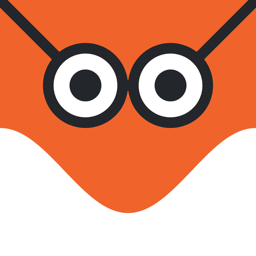

<p align="center">
  
</p>

<h1 align="center">coscene</h1>

<p align="center">A puzzle game where everyday setups turn out to be maths.</p>

<p align="center">
  <a href="https://github.com/vecvel/coscene/actions/workflows/ci.yml"></a>
  <a href="https://github.com/vecvel/coscene/releases/latest"></a>
  <a href="LICENSE"></a>
  
</p>

Cranes, mirrors, taps, gears, conveyor belts and cargo ships each hide a piece of maths: moments, reflection, ratios, permutations, volume. In coscene you set up the scene, submit it, and watch it play out. Nothing is judged until you submit, and every hint points at something you have seen in real life. After each solve the game names the idea you just used and adds it to your notebook.

It is made for anyone who likes puzzles, and works well for students who want to feel the maths rather than memorise it. It plays offline, in eight languages, with no ads and no account.

<!--
Demo: add a screen recording or screenshots at .github/media/demo.gif and uncomment.
<p align="center"></p>
-->

## Contents

- [Features](#features)
- [Download](#download)
- [Getting started](#getting-started)
- [Project structure](#project-structure)
- [Levels and translations](#levels-and-translations)
- [Contributing](#contributing)
- [License](#license)
- [Contact](#contact)

## Features

- 100 scenes across 10 places, built on eight puzzle types: balance levers, light and mirrors, shadows, water flow, parcel routing, combination locks, gear ratios and cargo packing.
- A new daily scene, generated from the date.
- Explicit submit: the result plays out step by step, with a ghost of your last attempt to compare against.
- Real-world hints, and a reveal after every solve that names the concept behind it.
- A notebook of every concept you have met.
- A profile with a cosIQ score, ranks and a card you can share.
- English, Hindi, Bengali, Assamese, Tamil, Telugu, Indonesian and Korean.
- Sound effects synthesized in code, haptics, and a reduced motion setting.
- Every puzzle is deterministic and checked by a solver, so each scene is known to have an answer.
- Optional level packs from a server, signed with Ed25519 and re-validated before they are played.

## Download

[](https://github.com/vecvel/coscene/releases/latest)

| Platform | Download | Requires | Build |
|---|---|---|---|
| Android | [coscene-android.apk](https://github.com/vecvel/coscene/releases/latest/download/coscene-android.apk) | Android 7.0 or newer | [](https://github.com/vecvel/coscene/actions/workflows/release.yml) |
| iOS | Build from source (see below) | iOS 13 or newer | [](https://github.com/vecvel/coscene/actions/workflows/build.yml) |

On Android, open the APK and allow installs from your browser or file manager when asked. Each release also has the Play bundle (`coscene-android.aab`) and a `SHA256SUMS` file to check the downloads:

```bash
sha256sum -c --ignore-missing SHA256SUMS
```

## Getting started

You need Flutter 3.44 or newer (Dart 3.12). For iOS, Xcode with CocoaPods. For Android, the Android SDK and JDK 17.

```bash
git clone https://github.com/vecvel/coscene.git
cd coscene
flutter pub get
```

Run the app on a connected device or simulator:

```bash
cd apps/coscene-mobile && flutter run
```

Run the tests:

```bash
for p in coscene-core coscene-content coscene-i18n; do (cd packages/$p && dart test); done
```

```bash
(cd packages/coscene-render && flutter test) && (cd apps/coscene-mobile && flutter test)
```

Build a release:

```bash
cd apps/coscene-mobile && flutter build apk --release
```

```bash
cd apps/coscene-mobile && flutter build ios --release
```

Without `android/key.properties` the Android build is signed with the debug key, which is fine for testing. Add `--dart-define=COSCENE_UNLOCK_ALL=true` to open every scene while testing.

## Project structure

```
apps/coscene-mobile        the app, with its ios/ and android/ projects
packages/coscene-core      puzzle engine, validators and solvers (pure Dart)
packages/coscene-content   levels as JSON, level generator, remote pack loader
packages/coscene-i18n      dictionaries for all eight languages
packages/coscene-render    drawing, logo and icons
```

Each package keeps its tests in `test/` and its scripts in `tool/`.

## Levels and translations

Levels live in `packages/coscene-content/levels/base/`, one file per place, and follow `packages/coscene-content/schema/level.schema.json`. After editing them, embed them into the app:

```bash
cd packages/coscene-content && dart run tool/generate_levels.dart --embed
```

Without `--embed` the tool regenerates all 100 levels from their seeds. Either way, nothing is written unless every level can be solved.

Text lives in `packages/coscene-i18n/locales/<code>.json`. After editing:

```bash
cd packages/coscene-i18n && dart run tool/embed_locales.dart
```

App icons and launch images are drawn from `packages/coscene-render/lib/src/logo.dart`. Store icons and the feature graphic are written to `build/store/`:

```bash
cd apps/coscene-mobile && flutter test tool/generate_icons_test.dart
```

Remote packs are off unless the app is built with `--dart-define=COSCENE_PACK_URL=https://...`. To sign a folder of pack files for upload:

```bash
cd packages/coscene-content && dart run tool/sign_pack.dart /path/to/folder
```

Signing uses `secrets/pack_signing_key.json`, made by `tool/keygen.dart` and never committed.

## Contributing

Bug reports, puzzle ideas, levels and translations are welcome. See [CONTRIBUTING.md](CONTRIBUTING.md) for setup and checks, and follow the [Code of Conduct](CODE_OF_CONDUCT.md). To report a security problem, see [SECURITY.md](SECURITY.md).

Releases are automatic: bumping `version:` in `apps/coscene-mobile/pubspec.yaml` on `main` builds, signs and publishes a new release. Changes are listed in [CHANGELOG.md](CHANGELOG.md).

## License

[MIT](LICENSE) © 2026 vecvel

## Contact

Made by [vecvel](https://github.com/vecvel). Open an [issue](https://github.com/vecvel/coscene/issues) for bugs and ideas, or email [support@vecvel.com](mailto:support@vecvel.com).
